# Sushi Zen Delivery

Sistema desktop de gestão para um delivery de sushi, feito em **Java Swing** com banco **Firebird**. Ele cobre o dia a dia do delivery:

- cadastro de clientes, produtos, formas de pagamento e gastos;
- atendimento de pedidos;
- relatórios em PDF de pedidos e de gastos por período.

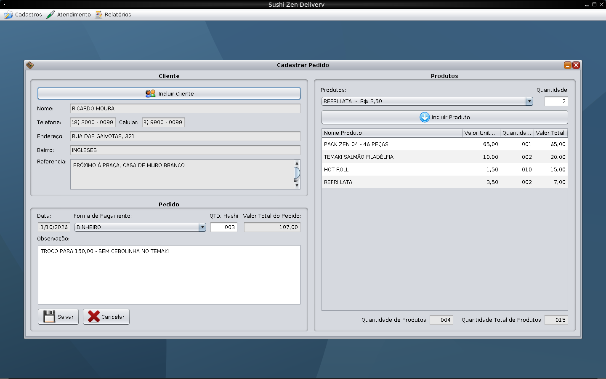

> Os prints deste README foram gerados com **dados fictícios** (clientes, pedidos e gastos de exemplo).

## Sumário

- [Tecnologias](#tecnologias)
- [Como rodar](#como-rodar)
- [Login](#login)
- [Menu principal](#menu-principal)
- [Clientes](#clientes)
- [Produtos](#produtos)
- [Formas de pagamento](#formas-de-pagamento)
- [Gastos e categorias de gasto](#gastos-e-categorias-de-gasto)
- [Pedidos (atendimento)](#pedidos-atendimento)
- [Relatórios](#relatórios)
- [Banco de dados](#banco-de-dados)
- [Estrutura do projeto](#estrutura-do-projeto)
- [Limitações conhecidas](#limitações-conhecidas)

## Tecnologias

| | |
|---|---|
| Linguagem | Java (código-fonte Java 7, roda em Java 8+) |
| Interface | Swing (look and feel Nimbus) + SwingX (`JXDatePicker`) |
| Banco de dados | Firebird 2.5 (arquivo `DBSUSHIZEN.FDB`) via Jaybird 2.1.6 |
| Relatórios | JasperReports 4.7 (exportação para PDF com iText) |
| IDE original | NetBeans (formulários `.form` + `build.xml` do Ant) |

## Como rodar

**Pré-requisitos:** Docker e um JDK 8 ou mais novo (testado com JDK 17 e 25).

```bash
./run.sh
```

O script:

1. sobe um **Firebird 2.5** no Docker (`docker-compose.yml`), na porta `3051`, usando uma cópia do banco em `docker/data/` (o `DBSUSHIZEN.FDB` original não é alterado);
2. compila o projeto em `build/classes`;
3. abre o sistema.

> O arquivo `.FDB` é do formato ODS 11, por isso precisa do Firebird **2.5**. O 3.0 ou mais novo só abre depois de backup e restore.

**Conexão com o banco.** O endereço pode ser trocado com a propriedade `-Dsushizen.db.url`, por exemplo `jdbc:firebirdsql:localhost/3051:/firebird/data/DBSUSHIZEN.FDB`. Sem ela, o sistema usa o endereço original da instalação no Windows, `localhost/3050:C:\DBSUSHIZEN.FDB`. O usuário e a senha do banco são `SYSDBA` / `masterkey`.

Para desligar o banco:

```bash
docker compose down
```

## Login

Ao abrir, o sistema pede uma senha numérica: **`112222334`**. Cancelar ou fechar a janela encerra o sistema.

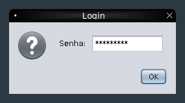

## Menu principal

A janela principal abre maximizada. As telas abrem como janelas internas, centralizadas, e são organizadas em três menus:

| Cadastros | Atendimento | Relatórios |
|---|---|---|
| 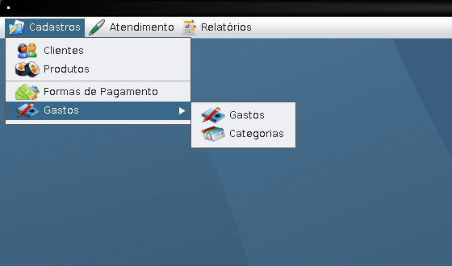 | 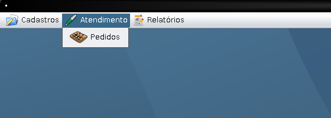 | 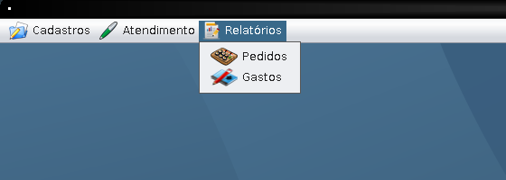 |
| Clientes, Produtos, Formas de Pagamento e Gastos (Gastos / Categorias) | Pedidos | Pedidos e Gastos |

Todas as telas de cadastro seguem o mesmo padrão:

- uma **lista** com pesquisa por nome, botão de recarregar e botão **Novo**;
- ao **clicar numa linha** da lista, abre a tela de edição, com os botões **Atualizar**, **Deletar** e **Cancelar**;
- o botão **Novo** abre a tela de cadastro, com **Salvar** e **Cancelar**;
- todos os textos são gravados em MAIÚSCULAS, e aspas e `%` são bloqueados nos campos.

## Clientes

**Cadastros → Clientes**

A lista mostra nome, telefone, celular e endereço, em ordem alfabética. A pesquisa filtra enquanto você digita.

| Lista de clientes | Pesquisa por nome |
|---|---|
| 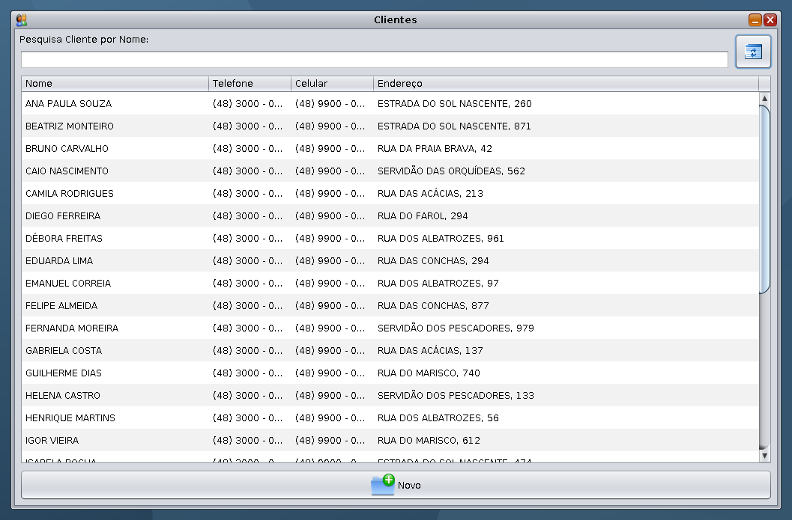 | 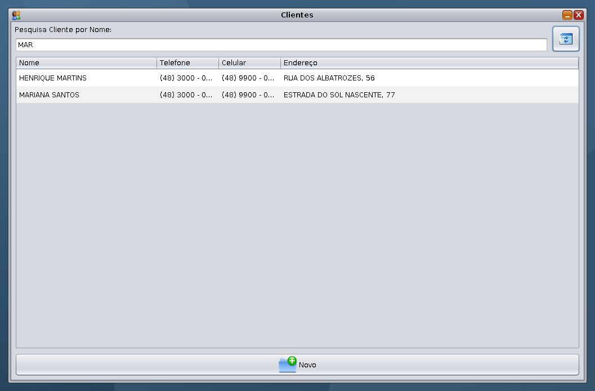 |

### Cadastro de cliente

Campos do cadastro:

- nome (obrigatório);
- data de nascimento (máscara `dd/mm/aaaa`);
- telefone e celular (máscara `(##) #### - ####`);
- e-mail, endereço e bairro;
- **referência** para o entregador;
- **como chegou até nós** (Google, indicação, folder…);
- observações.

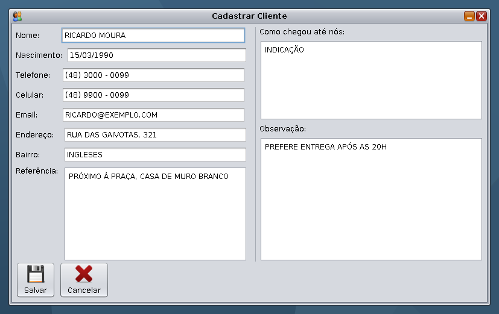

### Edição e exclusão

Clique no cliente na lista para editar. Antes de deletar, o sistema pede confirmação.

| Editar cliente | Confirmação de exclusão |
|---|---|
| 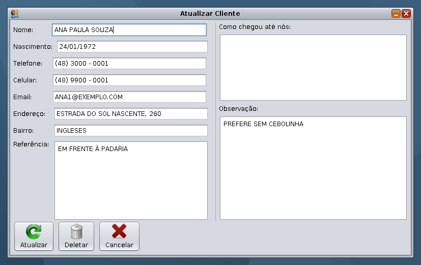 | 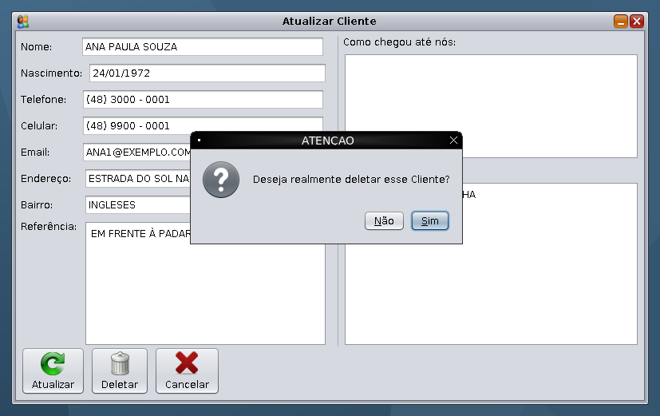 |

## Produtos

**Cadastros → Produtos**

Cardápio com nome, valor e descrição: packs, temakis, peças avulsas, bebidas etc. O campo de valor funciona como numa máquina registradora: ao digitar `3500` aparece `35,00`.

| Lista de produtos | Editar produto |
|---|---|
| 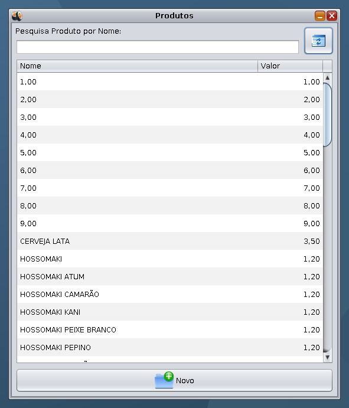 | 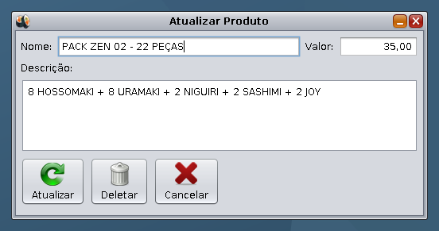 |

O nome é obrigatório em todos os cadastros:

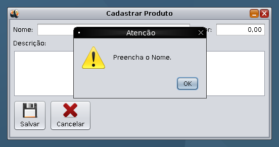

## Formas de pagamento

**Cadastros → Formas de Pagamento**

São as formas aceitas nos pedidos (dinheiro, cartão…), com nome e descrição.

| Lista | Editar |
|---|---|
| 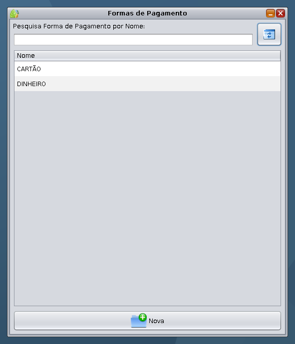 | 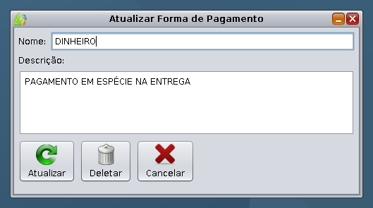 |

## Gastos e categorias de gasto

### Categorias de gasto

**Cadastros → Gastos → Categorias**

Agrupam as despesas: peixes, insumos, limpeza, gasolina, salários, marketing…

| Lista | Editar |
|---|---|
| 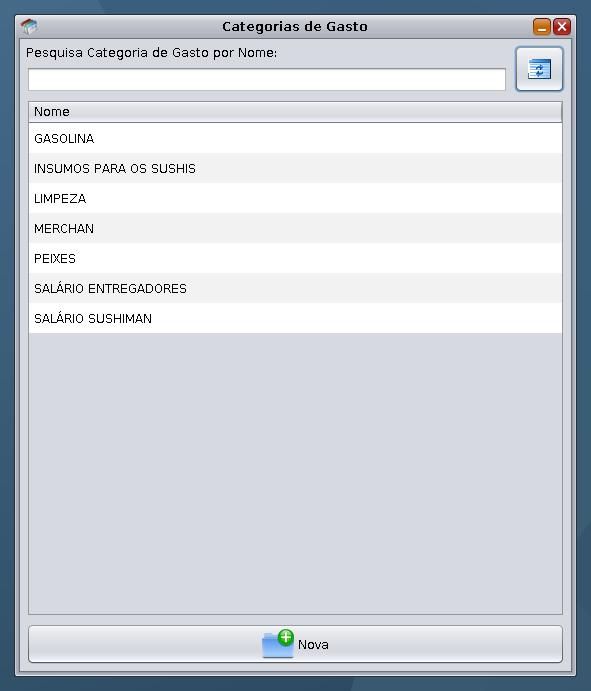 | 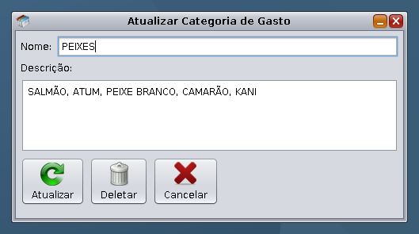 |

### Gastos

**Cadastros → Gastos → Gastos**

A lista mostra os gastos **de um dia**, escolhido no calendário (o padrão é hoje), com a categoria, a pesquisa por nome e o **total dos gastos** do dia.

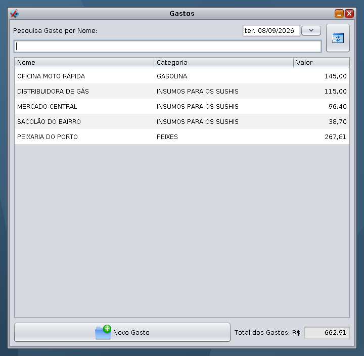

Cada gasto tem data, valor, nome (fornecedor), categoria e descrição.

| Novo gasto | Editar gasto |
|---|---|
| 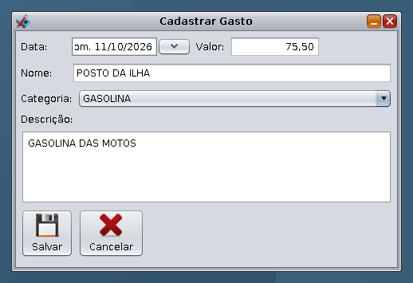 | 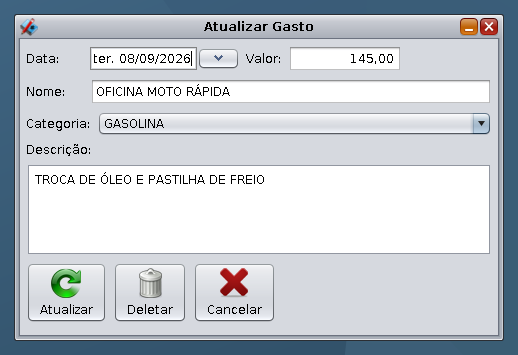 |

## Pedidos (atendimento)

**Atendimento → Pedidos**

A lista mostra os pedidos **de um dia**, escolhido no calendário, com o nome do cliente, o valor de cada pedido e o **total vendido no dia**. A pesquisa filtra pelo nome do cliente.

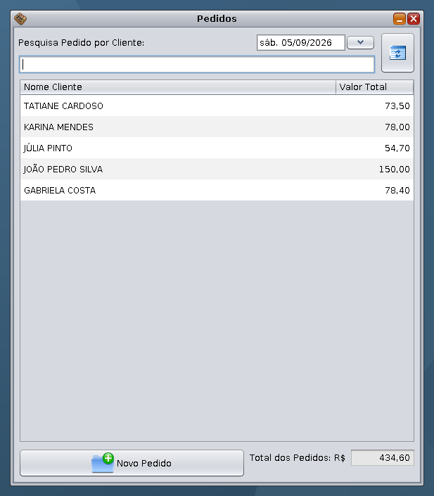

### Novo pedido

A tela de pedido tem três áreas:

- **Cliente:** o botão **Incluir Cliente** abre a lista de clientes para escolher. Depois de escolhido, os dados de entrega (telefones, endereço, bairro e referência) aparecem na tela.
- **Produtos:** escolha o produto, informe a quantidade e clique em **Incluir Produto** (ou tecle Enter). A tabela mostra o valor unitário, a quantidade e o valor total de cada item, e embaixo ficam a quantidade de itens e o total de peças.
- **Pedido:** data, forma de pagamento, quantidade de hashis, observação (troco, horário, pedidos especiais) e o **valor total do pedido**, calculado automaticamente.

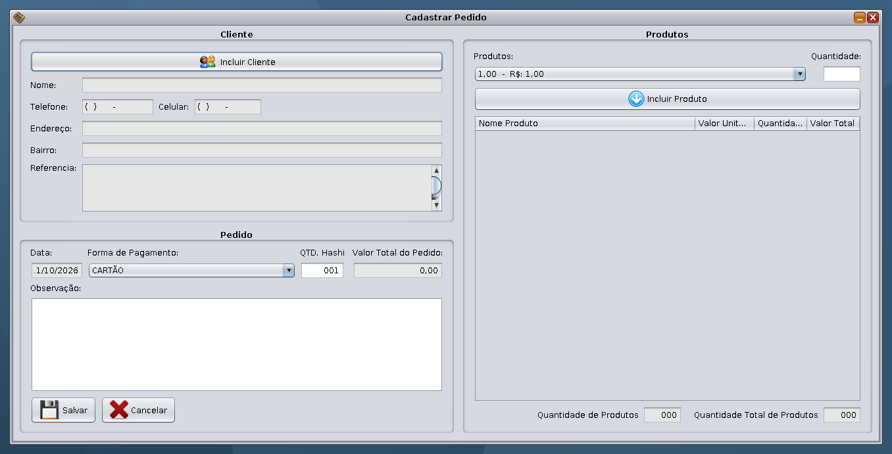

#### Escolha do cliente

Na escolha do cliente dá para pesquisar, **selecionar** (botão ou duplo clique), **editar** o cliente ou **cadastrar um novo** sem sair do pedido. Os botões ficam "Salvar e Selecionar" e "Atualizar e Selecionar".

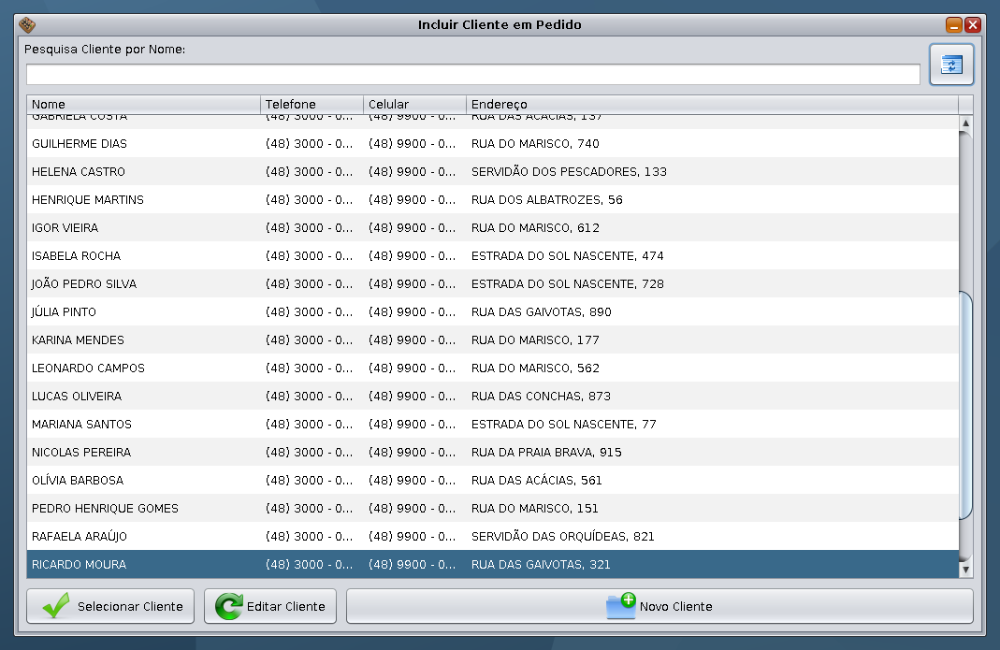

#### Pedido preenchido

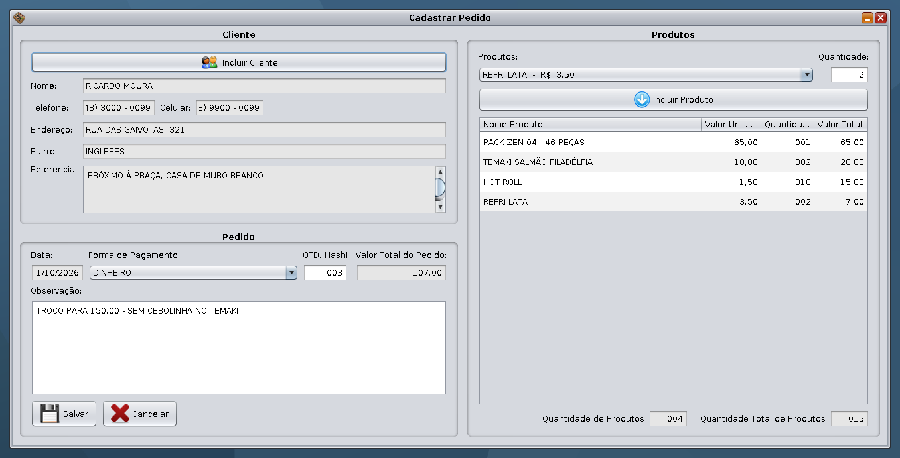

#### Alterar valor e excluir item

Com o **botão direito** num item da tabela, abre um menu com duas opções:

- **Alterar Valor:** muda o valor cobrado daquele item, para dar desconto ou cobrar um ajuste. O total do pedido é recalculado.
- **Excluir Produto:** remove o item do pedido.

| Menu do botão direito | Alterar valor do item |
|---|---|
| 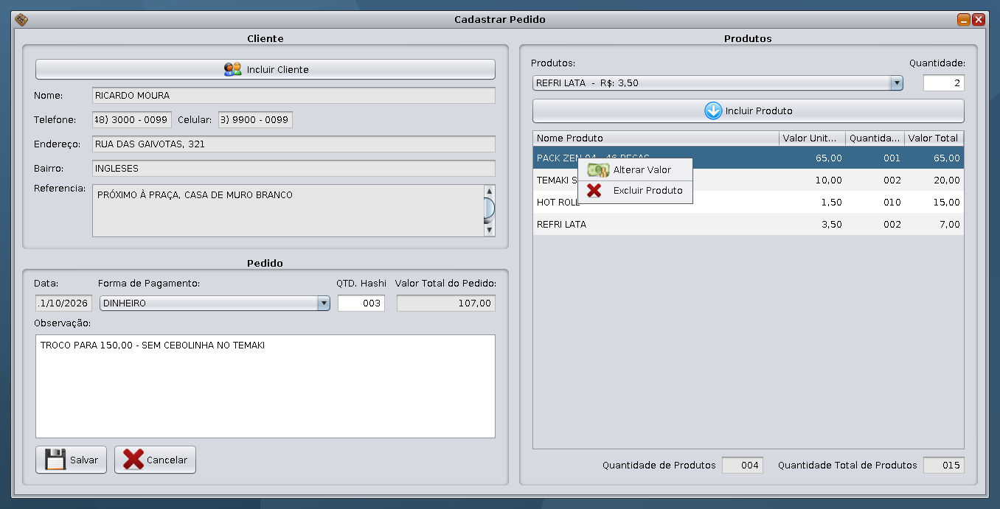 | 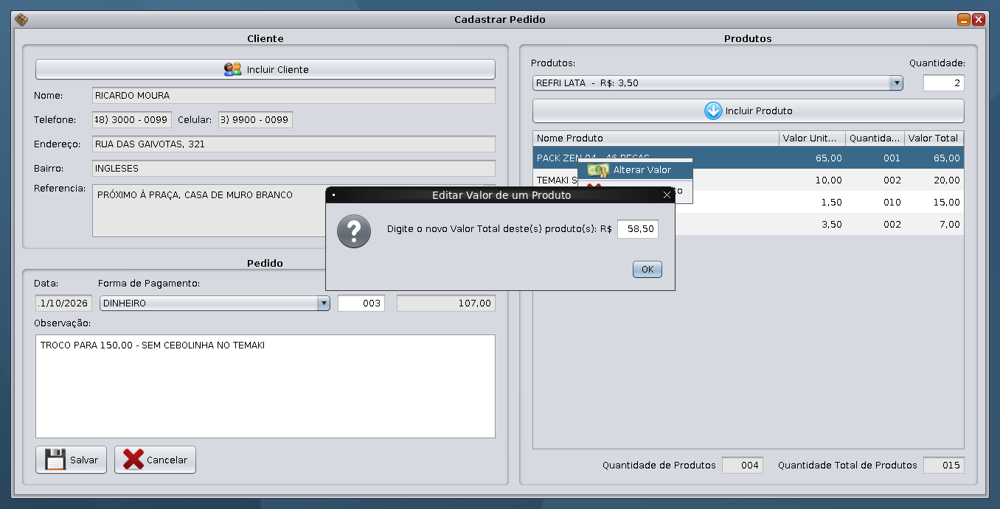 |

Resultado: o pack de R$ 65,00 passou a ser cobrado R$ 58,50 (10% de desconto), e o total do pedido caiu de R$ 107,00 para R$ 100,50.

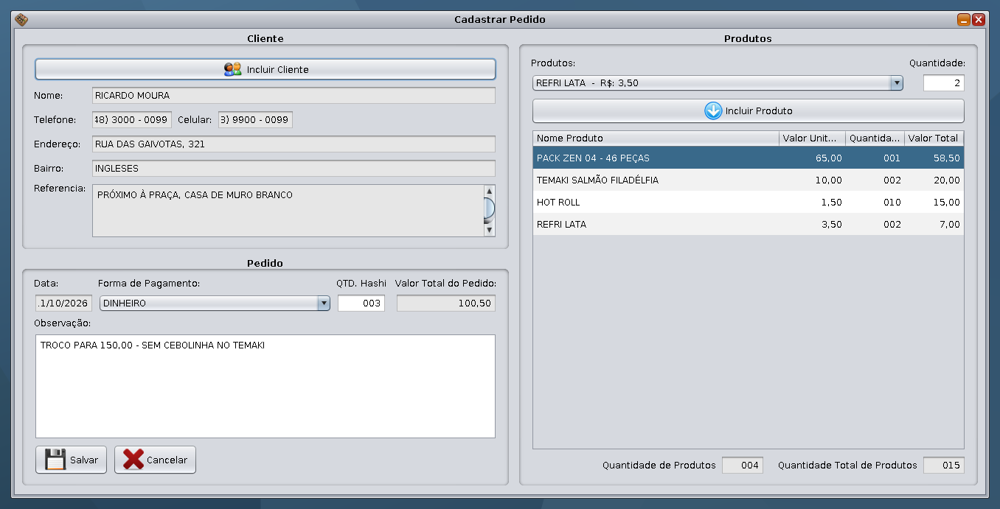

Ao salvar, o pedido entra na lista do dia:

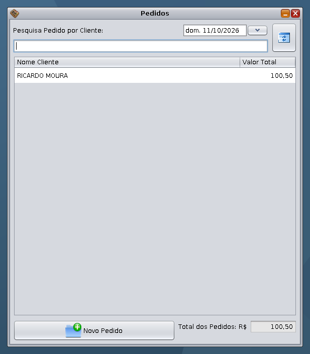

### Editar pedido

Clique num pedido da lista para abri-lo com cliente, itens, forma de pagamento e observação. Lá dá para **atualizar** (incluindo ou removendo itens) ou **deletar** o pedido.

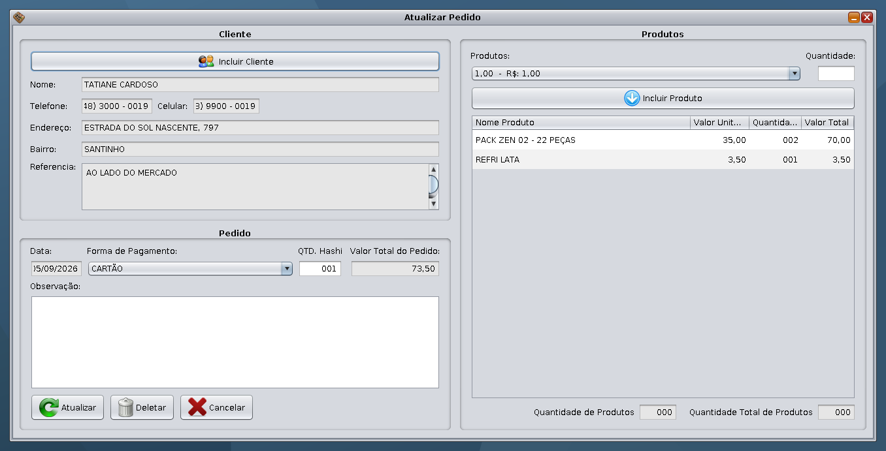

## Relatórios

Os dois relatórios funcionam do mesmo jeito:

1. escolha a **data inicial** e a **data final**;
2. clique em **Gerar Relatório**;
3. escolha onde salvar o PDF.

O sistema mostra uma tela de "Gerando relatório… Aguarde!" e, ao terminar, abre o PDF no leitor padrão.

### Relatório de pedidos

**Relatórios → Pedidos**

| Período | Onde salvar o PDF |
|---|---|
| 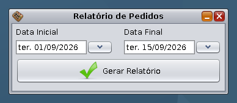 | 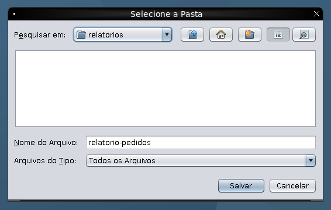 |

O PDF lista todos os pedidos do período com data, código, cliente, forma de pagamento e valor. No rodapé ficam a **quantidade de pedidos** e o **valor total**, da página e do relatório.

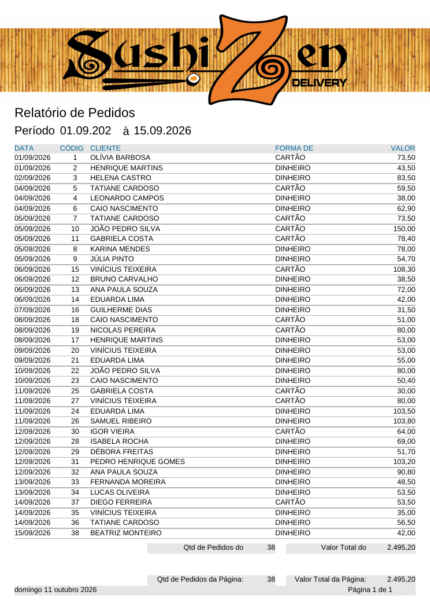

### Relatório de gastos

**Relatórios → Gastos**

| Período | Onde salvar o PDF |
|---|---|
| 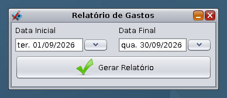 | 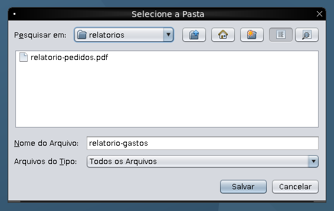 |

O PDF lista os gastos do período com data, código, nome, categoria e valor, além da **quantidade de gastos** e do **valor total**.

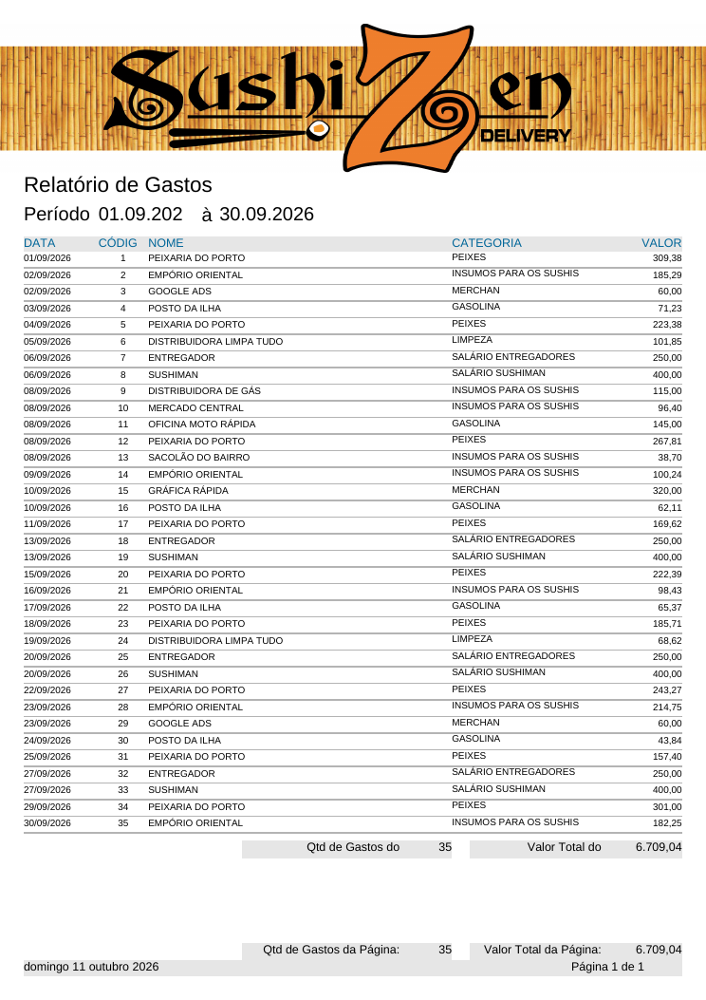

## Banco de dados

O banco é Firebird 2.5, dialeto 3. Os IDs são gerados por *generators* e *triggers* `BEFORE INSERT`.

```
CLIENTE              (id_cliente, nome, nascimento, telefone, celular, email, endereco,
                      bairro, referencia, como_chegou_ate_nos, observacao)
PRODUTOS             (id_produto, nome, descricao, valor)
FORMAS_DE_PAGAMENTO  (id_forma_de_pagamento, nome, descricao)
PEDIDOS              (id_pedido, id_cliente → CLIENTE, data, valor_total, observacao,
                      id_forma_de_pagamento → FORMAS_DE_PAGAMENTO)
PEDIDO_PRODUTOS      (id_pedido_produto, id_pedido → PEDIDOS, id_produto → PRODUTOS,
                      quantidade, valor_unitario, valor_total, valor_total_cobrado)
CATEGORIAS_GASTO     (id_categoria_gasto, nome, descricao)
GASTOS               (id_gasto, nome, descricao, valor, data,
                      id_categoria_gasto → CATEGORIAS_GASTO)
```

Em `PEDIDO_PRODUTOS`, `valor_total` é o valor de tabela (unitário × quantidade) e `valor_total_cobrado` é o valor realmente cobrado, depois de um "Alterar Valor".

## Estrutura do projeto

```
src/
├── br/sushi/zen/
│   ├── model/               entidades (Cliente, Produto, Pedido, Pedido_Produto, Gasto…)
│   ├── dao/                 acesso ao banco (JDBC) + Conexao
│   ├── interfaces/          contratos de CRUD e das telas
│   ├── interfacesGraficas/
│   │   ├── frames/          JanelaPrincipal (login + menu) e tela de "carregando"
│   │   └── jinternalframe/  telas de lista e cadastro de cada módulo + relatórios
│   ├── auxiliares/          campos com máscara/dinheiro, geração de relatórios
│   └── imagens/             ícones
├── Relatorios/              relatórios JasperReports (.jrxml / .jasper) e logo
└── *.jar                    bibliotecas (Jaybird, JasperReports, SwingX, iText…)
DBSUSHIZEN.FDB               banco de dados Firebird
docker-compose.yml           Firebird 2.5 para desenvolvimento
run.sh                       sobe o banco, compila e abre o sistema
```

## Limitações conhecidas

- **Quantidade de hashis:** o campo já existe na tela de pedido, mas ainda não é gravado no banco (falta a coluna e o SQL).
- **Login:** se a senha for digitada errada uma vez, a janela principal não abre nem com a senha certa. É preciso reabrir o sistema.
- **Relatórios:** os arquivos `.jasper` e `Placa.jpg` são procurados ao lado das classes, num caminho montado para o Windows. O `run.sh` já resolve isso: copia os arquivos e roda a partir de `/`.
